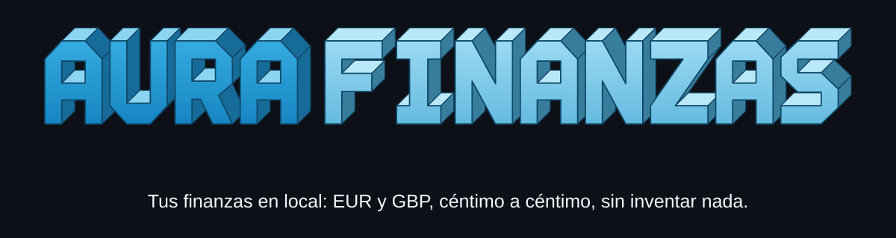
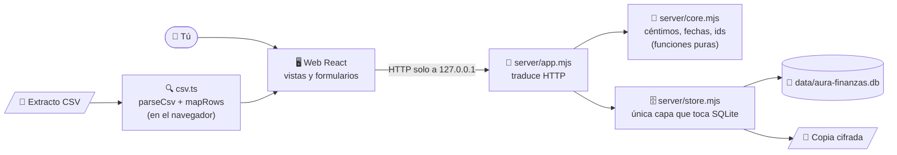
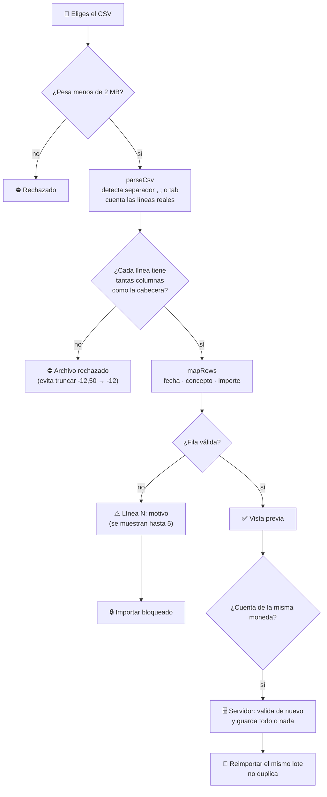
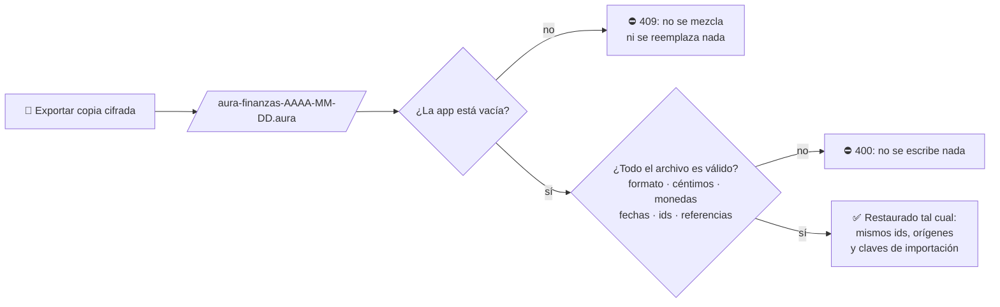
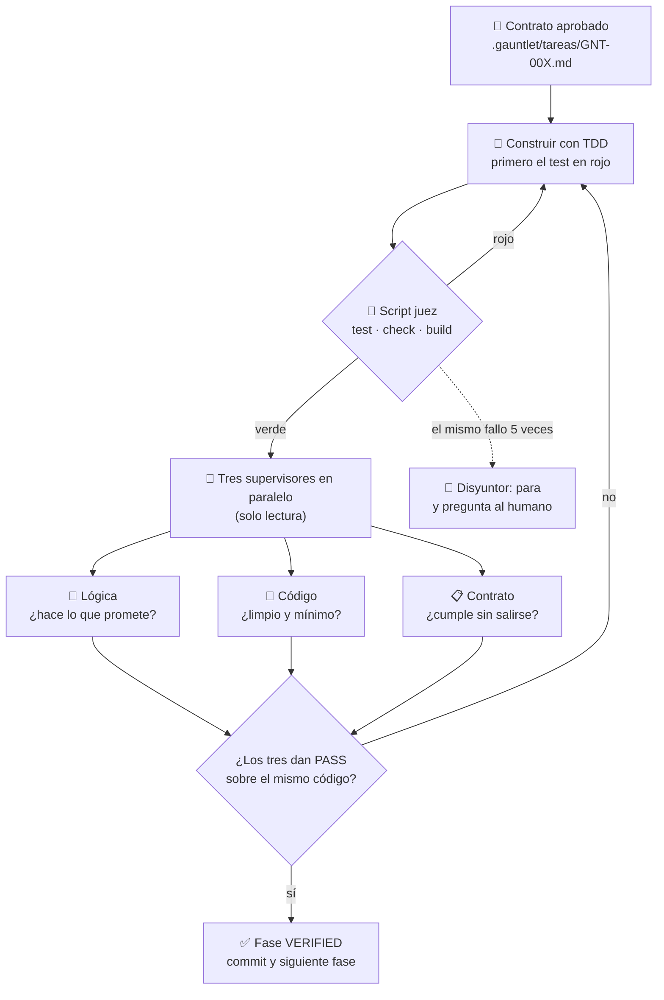

<p align="center">
  
</p>

<p align="center">
  
</p>

<p align="center">
  <b>Tu gestor financiero personal, local y sin trampas.</b><br>
  Cuentas, movimientos, presupuestos y extractos de bancos de España y Reino Unido.<br>
  EUR y GBP por separado, céntimo a céntimo. Nada sale de tu ordenador.
</p>

<p align="center">
  <a href="https://github.com/dajarony/finanzas/actions/workflows/ci.yml"></a>
  
  
  
  
  
</p>

> [!IMPORTANT]
> **MVP 0.1.** La API y sus reglas de negocio están cubiertas por tests automáticos. Antes de meter datos financieros reales, pruébalo en el navegador y lee las secciones **Limitaciones** y **Privacidad** de más abajo. No es un producto fiscal certificado.

---

## ✨ Qué hace

| | Función | En una frase |
|---|---|---|
| 📊 | **Panel** | Saldo, ingresos y gastos del mes, patrimonio estimado, 6 meses de evolución y gasto por categoría. |
| 💸 | **Movimientos** | Añadir ingresos y gastos, buscar en todo el historial, cargar más registros, categorizar y borrar. |
| 🏦 | **Cuentas** | Varias cuentas con saldo inicial; el saldo se calcula con sus movimientos. |
| ⚖️ | **Cuadrar con el extracto** | Escribes el saldo de tu banco en una fecha y te dice si cuadra o cuánto se desvía. |
| 🎯 | **Presupuestos** | Límite mensual por categoría y cuánto llevas gastado. |
| 🧾 | **Deudas** | Saldos pendientes que se restan del patrimonio. |
| 📥 | **Importar CSV** | Extractos de bancos ES y UK, con vista previa y sin adivinar nunca un importe. |
| 💾 | **Copia de seguridad** | Exportar una copia cifrada y restaurarla en una app vacía con la misma frase, todo o nada. |
| 🤖 | **Demo** | Datos ficticios para probar, que se quitan sin tocar los tuyos. |

---

## 🧭 Cómo funciona

Todo corre en tu ordenador. La web solo muestra y captura; **el servidor es la fuente de verdad** y valida cada petición.



| Capa | Hace | Nunca hace |
|---|---|---|
| `web/` | Muestra, captura y previsualiza el CSV | Decidir qué es válido: lo confirma el servidor |
| `server/app.mjs` | Convierte HTTP en llamadas al dominio | Lógica contable |
| `server/core.mjs` | Valida importes, fechas e identificadores | Leer archivos o red |
| `server/store.mjs` | Opera sobre SQLite en transacciones | Importar código web |

---

## 💶 Las reglas del dinero

Son las reglas que **ningún cambio puede romper** ([`AGENTS.md`](AGENTS.md)). Cada una está cubierta por tests.

| Regla | Qué significa en la práctica |
|---|---|
| 🪙 **Céntimos enteros** | `12,50 €` se guarda como `1250`. Nunca coma flotante. |
| 🚫 **EUR y GBP no se mezclan** | No se suman ni se convierten. Un `£12.50` en una cuenta EUR **se rechaza** al añadirlo a mano, en el CSV y al cuadrar. |
| ❓ **Lo ambiguo se rechaza** | `1.234` puede ser mil doscientos o uno coma dos: no se adivina. |
| 🧱 **Todo o nada** | Importar un lote o restaurar una copia: si una sola fila falla, no se escribe nada. |
| 🛡️ **Tus datos son tuyos** | Quitar la demo nunca borra lo tuyo; si hay movimientos propios en sus cuentas, se bloquea y avisa. |
| 🔢 **Errores claros** | Un error esperable responde 4xx con mensaje; nunca un 500 genérico. |

---

## 📥 Importar un extracto CSV



**Importes que entiende y que rechaza:**

| Entrada | Resultado | Por qué |
|---|---|---|
| `1.234,56` · `1,234.56` · `1 234,56` | ✅ `1234.56` | Separadores de miles de ES y UK |
| `(12,50)` · `12,50-` · `-€12,50` | ✅ `-12.50` | Negativos al estilo de los bancos |
| `1.234` · `1,234` | ⛔ | Ambiguo: ¿1234 o 1,234? |
| `£12.50` en una cuenta EUR | ⛔ | Sería convertir libras en euros |
| `+12,50-` · `12 50` · `0.123,45` | ⛔ | Signos contradictorios o separadores sueltos |
| Cargo **y** abono rellenos | ⛔ | No se sabe cuál es |
| Un `-` solo en cargo o abono | ✅ vacío | Así exporta Excel un cero contable |

Fechas: `AAAA-MM-DD`, `DD/MM/AAAA` o `DD.MM.AAAA`. Una fecha imposible (`31/02/2026`) o con año de dos cifras se rechaza.

---

## 💾 Copia de seguridad



Una copia de hasta **48 MiB** se acepta en la restauración; el resto de peticiones tienen un límite de 4 MiB. La restauración necesita la misma frase de acceso con la que se exportó.

---

## ⚖️ Cuadrar con el extracto

En **Cuentas**, pulsa **Cuadrar con extracto**, elige la fecha y escribe el saldo que muestra tu banco:

```text
saldo de la app en la fecha D = saldo inicial + suma de movimientos con fecha ≤ D
diferencia                    = saldo del extracto − saldo de la app
```

| Extracto | App | Resultado |
|---|---|---|
| `130,00 €` | `130,00 €` | ✅ **Cuadra** |
| `128,00 €` | `130,00 €` | ⚠️ No cuadra · Diferencia: **−2,00 €** (te falta un gasto o sobra un ingreso) |
| `£130.00` en una cuenta EUR | — | ⛔ Rechazado: otra moneda |

Es **solo una consulta**: no guarda nada ni corrige saldos.

---

## 🚀 Empezar

1. Instala **Node.js 22.13 o posterior** (mejor Node 22 LTS).
2. En la carpeta del proyecto:

```bash
npm install
npm run dev
```

3. Abre **http://127.0.0.1:5173**. La API escucha solo en **127.0.0.1:8787**.
4. Crea una frase de acceso de al menos 12 caracteres. Después pulsa **Explorar demo** para jugar con datos ficticios, o ve a **Cuentas y deudas** para crear las tuyas.

Para una única app que sirva la API y la web desde Node:

```bash
npm run build
npm start
```

y abre **http://127.0.0.1:8787**.

---

## 🧪 Calidad

```bash
npm run check:architecture # DOCBLOCKs, rutas SUME y dependencias
npm test         # servidor, seguridad, API y lógica CSV de la web
npm run check    # tipos de TypeScript
npm run build    # compilación de la web
npx playwright install chromium
npm run test:e2e # recorrido real en Chromium con base temporal
npm run verify   # ejecuta todo el banco anterior
```

El [CI de GitHub](.github/workflows/ci.yml) ejecuta el gate arquitectónico, tests, tipos, compilación y navegador en cada PR y en cada cambio de `main`.

| Archivo de tests | Qué protege |
|---|---|
| `tests/store.test.mjs` · `tests/api.test.mjs` | Reglas de negocio e integración HTTP |
| `tests/demo.test.mjs` | La demo crea lo que promete y quitarla nunca borra datos reales |
| `web/src/lib/csv.test.ts` | Importes, fechas, columnas y monedas del CSV |
| `tests/restore.test.mjs` | Ida y vuelta de la copia, todo o nada, 409 y 400 |
| `tests/reconcile.test.mjs` | Cuadre con el extracto, signos y monedas |
| `tests/vault.test.mjs` | Frase, cifrado, migración, sesión y copias autenticadas |
| `tests/e2e/flows.spec.ts` | Apertura, cuentas, gasto, CSV, monedas, copia, bloqueo y móvil en Chromium |

---

## 🛡️ Cómo se construye: AURA Gauntlet

Las fases 1 a 4 se hicieron con **AURA Gauntlet**, un bucle en el que nada se da por bueno porque alguien diga que funciona: lo deciden un **script** y **tres supervisores** que no pueden tocar el código.

Para los cambios nuevos, [sus gates](.gauntlet/gates.json) incluyen también
arquitectura SUME y navegador. La [plantilla de PR](.github/pull_request_template.md)
pide revisar responsabilidades, contratos y pruebas reales.



Lo que encontraron los supervisores durante el plan, y quedó corregido con su test:

- 🐛 La demo **nunca creaba sus presupuestos** (faltaba un argumento y el error quedaba oculto).
- 🐛 Un `-12,50` sin comillas en un CSV con comas se importaba como **-12,00 €** sin avisar.
- 🐛 Al cambiar de moneda en la vista, un extracto en **libras podía guardarse como euros**.
- 🐛 Un presupuesto de la demo que el usuario editaba **se borraba sin avisar** al quitar la demo.
- 🐛 Una copia editada a mano podía colar **fechas imposibles** o ids que la app no podría borrar después.

---

## 🧱 Flujo modular de desarrollo

El [flujo de extremo a extremo](docs/DEVELOPMENT-FLOW.md) combina contratos
Dajarony, SUME/STDG y ECA con diseño de módulos, diagnóstico, TDD y revisión
de `skill2`. Las reglas inspiradas en Karpathy se aplican como disciplina de
alcance y verificación, sin instalar skills duplicadas. Leer
[`AGENTS.md`](AGENTS.md), [`STATUS.md`](STATUS.md), [`CONTEXT.md`](CONTEXT.md)
y el [mapa](mapa-global/arquitectura.yaml) antes de una modificación estructural.

---

## ⚠️ Limitaciones

- **Sin conexión bancaria directa** (Open Banking aún no integrado).
- Sin extracción de PDF, OFX, QIF ni OCR, y sin IA para facturas: están planeados.
- **Sin conversiones de divisas.** El patrimonio se calcula por moneda; no hay un total EUR + GBP.
- **Deudas manuales:** los movimientos no liquidan una deuda automáticamente.
- **Conciliación limitada:** puedes comprobar a mano si una cuenta cuadra con tu extracto, pero la app no guarda conciliaciones, no ajusta saldos ni modela transferencias internas.
- **CSV:** reconoce algunas cabeceras habituales; revisa siempre signos y columnas antes de importar. La deduplicación por lote no es una identidad bancaria universal: un extracto parcial reordenado puede requerir revisión manual.
- **Restaurar solo en una app vacía:** no se fusiona ni se reemplaza nada.
- **Solo una persona y uso local.** La frase de acceso desbloquea el almacén cifrado y una sesión local; no hay cuentas de usuario ni HTTPS. No expongas el puerto a Internet. Solo escucha en localhost.
- El backend usa `node:sqlite` para pruebas y migración heredada, y `better-sqlite3-multiple-ciphers` para el almacén cifrado.
- Fiscalidad ES/UK, previsiones, inversiones, sincronización y recordatorios están pendientes ([`docs/ROADMAP.md`](docs/ROADMAP.md)).

---

## 🔒 Privacidad y almacenamiento

- Los datos viven en `data/aura-finanzas.db`, en el mismo equipo que ejecuta Node. `data/` está excluido de Git.
- Al abrir por primera vez, crea una frase de al menos 12 caracteres. Sin ella no se puede abrir la base ni restaurar una copia cifrada. Guárdala fuera del equipo.
- Exporta copias cifradas `.aura` desde la app. Una copia directa del archivo SQLite cifrado requiere también `aura-finanzas.db.vault.json` y la misma frase de acceso.
- Si había una base antigua sin cifrar, Aura crea un archivo `aura-finanzas.db.plaintext-*` antes de migrar. Comprueba que todos tus datos están presentes y retira ese archivo manualmente cuando ya no lo necesites: sigue conteniendo información legible.
- Los CSV se interpretan **en el navegador** y los movimientos ya normalizados solo se envían a la **API local**. Sin servicios de IA ni analítica externa; las fuentes son las del sistema.

> [!WARNING]
> **Antes de registrar extractos reales:** revisa el código y haz una copia cifrada de prueba. La protección cubre los archivos en reposo y las copias exportadas; alguien con control del equipo mientras Aura esté desbloqueada podría acceder a los datos. No la uses en un ordenador compartido.

---

## 🗂️ Estructura del código

```text
server/
  core.mjs           → importes en céntimos, fechas y validación sin I/O
  store.mjs          → conexión SQLite, esquema y composición
  store/             → cuentas, movimientos, importación, presupuestos, deudas, panel, conciliación, copias, demo
  vault.mjs          → frase de acceso, sesión local y metadatos
  vault/             → cifrado de copias y migración de bases anteriores
  app.mjs            → seguridad HTTP y servido estático
  routes.mjs         → despacho de rutas API
  http.mjs           → lectura y respuesta JSON
  index.mjs          → arranque local en 127.0.0.1
web/src/
  App.tsx            → composición, navegación y datos de las vistas
  features/          → acceso, nuevo movimiento y copias
  views/             → Overview, Transactions, Budgets, Accounts, ImportCsv
  lib/csv.ts         → parseCsv, mapRows, cuenta de destino (puro y testeado)
  lib/format.ts      → importes, fechas y formato de moneda
  lib/api.ts         → cliente HTTP tipado
tests/               → store, api, demo, restore, reconcile, vault, e2e
entradas/, logica/, salidas/, contratos/ → índices y contratos SUME
mapa-global/, cambios/ → trazabilidad STDG
assets/              → banner 3D, mascota Aura y su generador
.gauntlet/           → gates y contratos del plan F1–F4
docs/                → arquitectura, flujo, playbook, ECA, roadmap y seguridad
```

---

## 📄 Licencia

Proyecto original de Aura Finanzas, **sin licencia de redistribución seleccionada**. La inspiración conceptual viene del estudio de herramientas financieras local-first, pero no se ha copiado código del proyecto Counting House. Si vas a publicar el repositorio, elige antes una licencia.

<p align="center"><sub>El banner y la mascota siguen el estilo de <b>Notas Aura</b>: el banner se genera con <code>python assets/generar-banner.py</code>.</sub></p>
