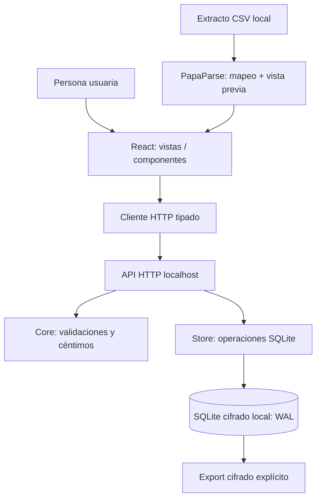

# Arquitectura v0.1 — módulos por responsabilidad

## Propósito y límites

Sistema local de finanzas personales; **no** fintech conectado a bancos. Datos reales nunca se inventan. Divisas se contabilizan por separado. El backend es fuente de verdad y valida cualquier petición.

## Contratos de dominio

- **Cuenta:** `{id, name, currency, opening_minor}`. Saldo = saldo inicial + suma de movimientos.
- **Movimiento:** `{account_id,date,description,amount_minor,category,note}`. Positivo = ingreso; negativo = gasto. Nunca `float` monetario.
- **Presupuesto:** `{month,currency,category,limit_minor}`. Consumo = gastos negativos de esa categoría y mes; ingresos no reducen consumo.
- **Deuda:** importe pendiente declarado; resta del patrimonio estimado. No presume pagos automáticos.
- **Patrimonio por divisa:** suma de cuentas - saldos declarados de deudas de esa divisa.
- **Importación:** validación total previa, inserción con BEGIN IMMEDIATE/COMMIT, deduplicación por huella de cuenta+fecha+concepto+importe y número de ocurrencia. La deduplicación no reemplaza ID oficial de banco ni conciliación de saldos.

## Dependencias permitidas

- `web/views` importan `web/lib/api`, `web/lib/format`, `web/components`, `web/types`.
- `web/lib/api` no depende de vistas.
- `server/app` protege Host/Origin y sirve archivos; `server/routes` despacha la API; `server/http` lee y escribe JSON.
- `server/store.mjs` abre SQLite y compone `server/store/{accounts,transactions,importer,budgets,debts,dashboard,reconcile,backup,demo}.mjs`.
- Solo `server/store.mjs` y el árbol `server/store/` acceden a SQLite; no importan código web.
- `server/core` valida reglas de dominio y no accede a archivos, SQLite ni red.

## Seguridad por defecto

- Host enlazado a `127.0.0.1` de manera fija.
- Host HTTP y Origin comprobados contra localhost.
- Sin llamadas a IA ni APIs de terceros.
- Validación de tamaño de mensaje (4 MiB), importación máxima 2.000 filas/lote, fechas e importes estrictos.
- JSON sin interpolación SQL para campos de usuario; sentencias preparadas.
- CSP y cabeceras defensivas en contenido de producción.
- `server/vault.mjs` mantiene sesión y metadatos; `server/vault/crypto.mjs` deriva la clave con scrypt y cifra copias con AES-256-GCM; `server/vault/migration.mjs` conserva y verifica la base anterior. Las sesiones HTTP usan cookie HttpOnly.
- La base original de una migración permanece en claro como archivo de recuperación hasta que la persona compruebe y retire esa copia.

## Integración SUME + STDG

El [mapa global](../mapa-global/arquitectura.yaml) enlaza cada ruta con entradas, controlador, lógica, contrato y salida reales. El [contrato HTTP](../contratos/http-api.md) fija la interfaz y el [oráculo ECA](../contratos/eca-oraculo.md) los resultados observables. Las carpetas SUME son índices; no duplican módulos. `npm run check:architecture` comprueba DOCBLOCKs, rutas y rutas de archivo.

La web mantiene `App.tsx` como composición de vistas; `features/auth/AccessGate.tsx` posee la sesión, `features/transactions/NewTransaction.tsx` el formulario de alta y `features/backup/BackupControls.tsx` la exportación/restauración. No introducir abstracciones sin necesidad demostrada.
