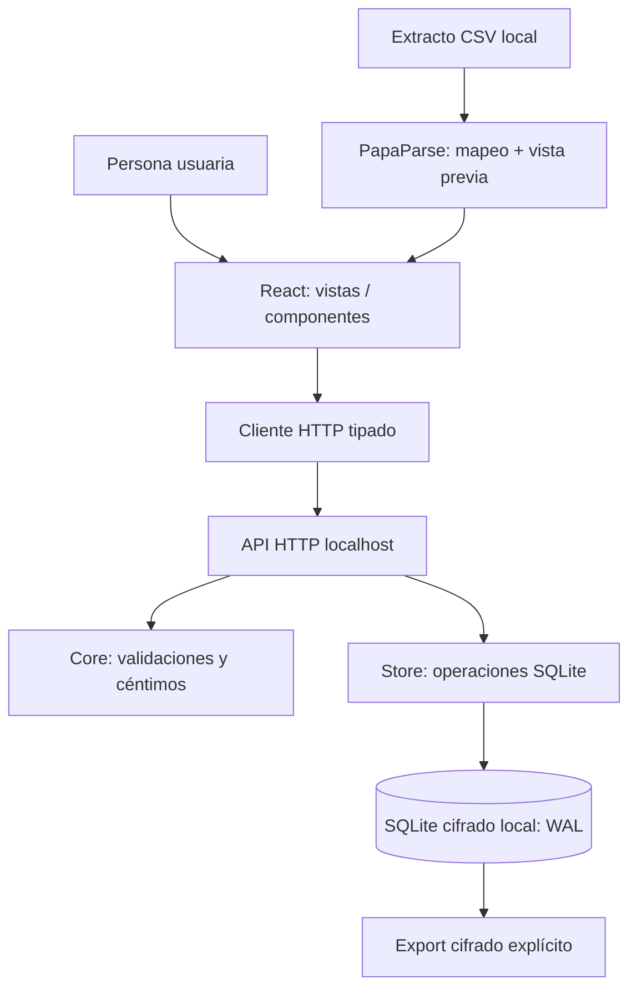

# Arquitectura v0.1 — módulos con responsabilidad única

## Propósito y límites

Sistema local de finanzas personales; **no** fintech conectado a bancos. Datos reales nunca se inventan. Divisas se contabilizan por separado. El backend es fuente de verdad y valida cualquier petición.

## Contratos de dominio

- **Cuenta:** `{id, name, currency, opening_minor}`. Saldo = saldo inicial + suma de movimientos.
- **Movimiento:** `{account_id,date,description,amount_minor,category,note}`. Positivo = ingreso; negativo = gasto. Nunca `float` monetario.
- **Presupuesto:** `{month,currency,category,limit_minor}`. Consumo = gastos negativos de esa categoría y mes; ingresos no reducen consumo.
- **Deuda:** importe pendiente declarado; resta del patrimonio estimado. No presume pagos automáticos.
- **Patrimonio por divisa:** suma de cuentas - saldos declarados de deudas de esa divisa.
- **Importación:** validación total previa, inserción con BEGIN IMMEDIATE/COMMIT, deduplicación por huella de cuenta+fecha+concepto+importe y número de ocurrencia. La deduplicación no reemplaza ID oficial de banco ni conciliación de saldos.

## Dependencias permitidas

- `web/views` importan `web/lib/api`, `web/lib/format`, `web/components`, `web/types`.
- `web/lib/api` no depende de vistas.
- `server/app` no implementa operaciones contables; solo traduce HTTP al dominio.
- `server/store` depende de `server/core` y SQLite; no importa código web.
- `server/core` contiene funciones puras; no accede a archivos ni a la red.

## Seguridad por defecto

- Host enlazado a `127.0.0.1` de manera fija.
- Host HTTP y Origin comprobados contra localhost.
- Sin llamadas a IA ni APIs de terceros.
- Validación de tamaño de mensaje (4 MiB), importación máxima 2.000 filas/lote, fechas e importes estrictos.
- JSON sin interpolación SQL para campos de usuario; sentencias preparadas.
- CSP y cabeceras defensivas en contenido de producción.
- `server/vault.mjs` deriva una clave de la frase con scrypt, abre SQLite cifrado y emite sesiones HttpOnly de uso local. Las copias usan AES-256-GCM con sal e IV nuevos.
- La base original de una migración permanece en claro como archivo de recuperación hasta que la persona compruebe y retire esa copia.

## Integración SUME + STDG

El [mapa global](../mapa-global/arquitectura.yaml) enlaza entradas, lógica, salidas y contratos con los módulos ejecutables existentes. El [oráculo ECA](../contratos/eca-oraculo.md) fija resultados observables. Las carpetas SUME son índices de responsabilidad y trazabilidad; no duplican módulos.

## Próxima refactorización

Si el repo crece, separar `server/store.mjs` en **repositorios individuales** (`accounts`, `ledger`, `budgets`, `debts`, `importer`, `analytics`), todos tras interfaces/contratos estables. No introducir abstracciones sin duplicación real o necesidad de pruebas.
