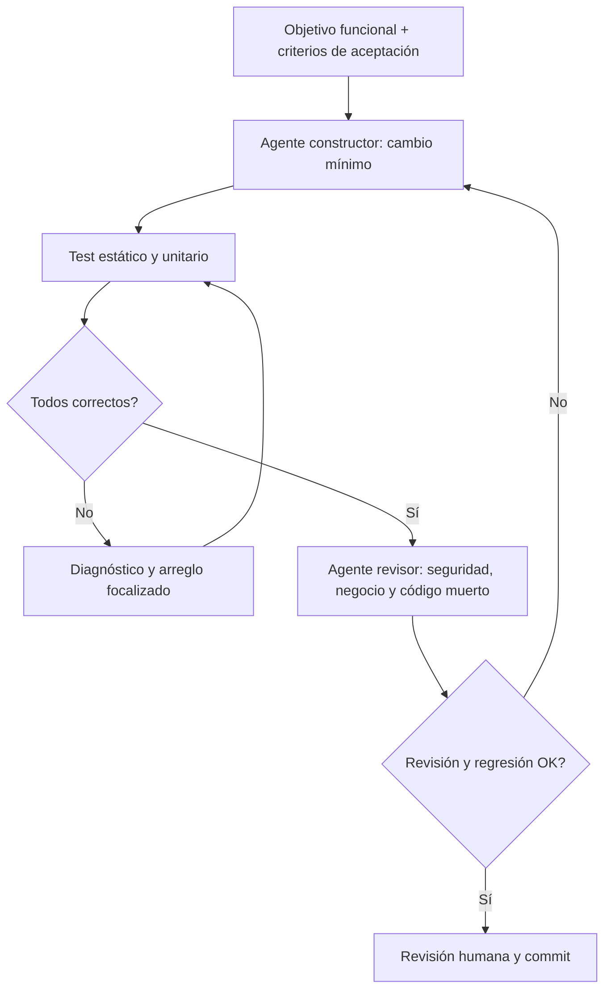

# Integración ECA + SUME + STDG

> El [oráculo ECA](../contratos/eca-oraculo.md) fija diez comportamientos observables; las pruebas de API, almacén y navegador los ejercitan en bases temporales. El [mapa SUME + STDG](../mapa-global/arquitectura.yaml) documenta las conexiones reales y el [registro](../cambios/registro-cambios.md) conserva las modificaciones.

## SUME: bloques independientes

| Bloque | Entrada | Salida | Invariante |
| --- | --- | --- | --- |
| `accounts` | nombre, moneda, saldo | cuenta | saldo inicial en céntimos |
| `ledger` | movimiento validado | asiento | cantidad no nula, moneda ligada a cuenta |
| `importer` | lote CSV normalizado | insertados/omitidos | atomicidad: todo o nada ante errores |
| `budgets` | categoría, mes, límite | consumo | gastos exclusivamente negativos |
| `debts` | descripción, saldo | deuda | saldo no negativo |
| `analytics` | cuentas y movimientos | métricas | EUR y GBP nunca se mezclan |
| `audit` (futuro) | acción, actor, cambio | histórico | registro inmutable y trazable |

## Ciclo ECA de calidad (propuesta)

**Restricciones del loop:** nunca alterará importes reales para hacer que los tests pasen; no borrará datos sin confirmación; no publicará extractos en logs, PR o mensajes. Límite de intentos y reporte de bloqueo; cada iteración añade/actualiza pruebas de aceptación.

## Primeros criterios de aceptación

1. Dos compras idénticas en un extracto no se colapsan.
2. Reimportar exactamente el mismo lote no duplica transacciones.
3. Invalidar una sola fila rechaza el lote completo.
4. Cambiar de GBP a EUR nunca suma ambas monedas.
5. El saldo respeta el inicial y todos los movimientos, aun cuando el filtro mensual cambia.
6. Borrar una operación actualiza totales y presupuesto.
7. Quitar la demo elimina sus cuentas y presupuestos, no los datos reales.
8. Nunca usar coma flotante para almacenar importes.

Los primeros ocho tienen cobertura de distinto nivel en `tests/*.test.mjs`; `tests/e2e/flows.spec.ts` añade un recorrido de navegador sobre Chromium. Siguen pendientes pruebas de concurrencia entre procesos, accesibilidad con lectores de pantalla y extractos de bancos adicionales.

Para reproducir el banco completo en un equipo nuevo: `npm ci`, `npx playwright install chromium` y `npm run verify`. El resultado observado de esta iteración está en [`docs/ECA-RESULTS.md`](ECA-RESULTS.md).
